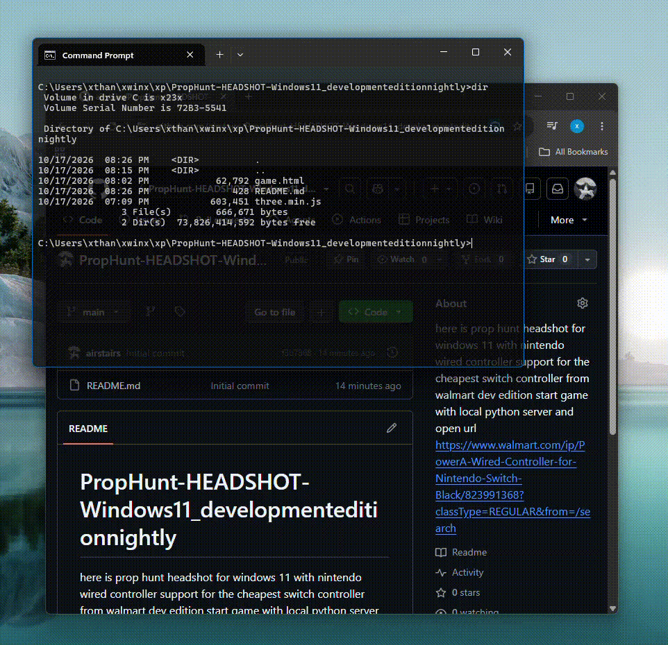

# PropHunt-HEADSHOT-Windows11_developmenteditionnightly

  

### works with wired switch controller  

here is prop hunt headshot for windows 11 with nintendo wired controller support for the cheapest switch controller from walmart dev edition start game with local python server and open url   https://www.walmart.com/ip/PowerA-Wired-Controller-for-Nintendo-Switch-Black/823991368?classType=REGULAR&amp;from=/search

see gif below:  

   

gif recorded using snipping tool on windows 11 using walmart hp 14 and walmart power a wired switch controller i got mine for $5 on sale but prices vary 16.99 ordering from website on my pages

pro tip... you can push left d pad to re drop in to the same round after death or black scrn from blue target hit cool 

pro tip... you can auto start the game on both windows and android if yiu have keybosrd and mouse/controller in android and windoes respectively by cding to project folder in cmd prompt and running startgame.bat in termux sh startgame.sh
